


 

 



Desarrollador Full Stack · entusiasta del desarrollo de aplicaciones robustas, desde interfaces pulidas hasta una lógica de backend y bases de datos sólidas. Me adapto a las necesidades de cada proyecto y me encanta transformar ideas en experiencias funcionales.


  

<a href="https://brandonalvis.vercel.app/"></a>





<picture>
  <source media="(prefers-color-scheme: dark)" srcset="https://raw.githubusercontent.com/platane/snk/output/github-contribution-grid-snake-dark.svg" />
  
</picture>


Si te gusta mi trabajo, puedes invitarme un café ☕

  ⭐️ Transformando problemas en soluciones, un commit a la vez | Brandon Alvis · <a href="https://github.com/NoName-IA">@NoName-IA</a>

